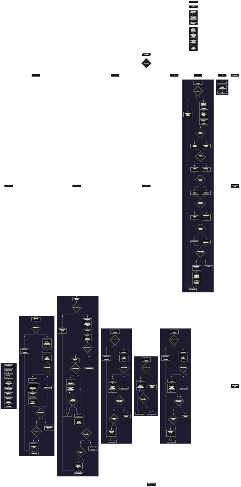

 

Este proyecto, llamado <b>asistente bancario</b>, fue desarrollado en <b>pseint</b> como un ejercicio práctico para fortalecer la lógica de programación mediante la creación de un sistema de gestión de cuentas bancarias desde la consola. El programa cuenta con un menú principal de ocho opciones que permite <b>registrar, editar, eliminar, buscar, listar, consultar los detalles y mostrar estadísticas</b> de las cuentas bancarias registradas. Cada cuenta almacena información como el nombre del cliente, el número de cuenta, el tipo de cuenta, el saldo y el estado, utilizando seis arreglos con una capacidad definida de <b>100 posiciones durante la ejecución</b>. Durante su desarrollo se aplicaron conceptos fundamentales de programación, como variables, arreglos, estructuras condicionales, ciclos repetitivos y estructuras de selección, además de procesos para buscar, modificar, eliminar y organizar registros. Asimismo, se incorporaron cálculos para obtener el saldo total, el saldo promedio, el mayor saldo, el menor saldo y la cantidad de cuentas según su estado. Este proyecto permite poner en práctica los conocimientos adquiridos en PSeInt y sirve como base para desarrollar sistemas de gestión financiera más avanzados utilizando otros lenguajes y tecnologías.

<h2 align="center">⚙️ Funcionamiento del menú principal</h2>

### ➕ Registrar cuenta bancaria

La opción <b>1) registrar cuenta bancaria</b> permite incorporar una nueva cuenta al sistema. Al comenzar, el programa asigna un identificador automático utilizando la variable <b>siguienteID</b> y aumenta su valor en uno para el próximo registro. Después, solicita el <b>nombre del cliente, número de cuenta, tipo de cuenta, saldo inicial y estado</b>. Los datos se almacenan en la posición correspondiente de los seis arreglos: <b>id, cliente, numeroCuenta, tipoCuenta, saldo y estado</b>. Finalmente, incrementa la variable <b>totalCuentas</b> en uno y muestra el mensaje <b>"cuenta bancaria registrada correctamente."</b>. En el código actual no se comprueba si los arreglos han alcanzado su capacidad máxima de 100 posiciones ni se validan los datos introducidos.

### ✏️ Editar cuenta bancaria

La opción <b>2) editar cuenta bancaria</b> permite modificar la información de una cuenta registrada. Primero, el programa comprueba si la variable <b>totalCuentas</b> es igual a cero. Si no existen cuentas, muestra el mensaje <b>"no hay cuentas registradas."</b>. En caso contrario, presenta una lista con el ID, cliente, número de cuenta, tipo de cuenta, saldo y estado de cada registro. Después, solicita el ID de la cuenta que se desea editar y utiliza la variable lógica <b>encontrado</b> para determinar si existe una coincidencia. Cuando encuentra el ID, solicita el nuevo nombre del cliente, número de cuenta, tipo de cuenta, saldo y estado, actualizando directamente los valores de los arreglos correspondientes. El identificador de la cuenta permanece sin cambios. Finalmente, muestra el mensaje <b>"cuenta bancaria editada correctamente."</b>. Si no encuentra el ID solicitado, presenta el mensaje <b>"no se encontro una cuenta con ese id."</b>.

### 🗑️ Eliminar cuenta bancaria

La opción <b>3) eliminar cuenta bancaria</b> permite eliminar una cuenta mediante su identificador. Antes de comenzar, el programa comprueba si existen cuentas registradas. Si no hay registros, muestra el mensaje <b>"no hay cuentas registradas."</b>. Si existen cuentas, presenta una lista con los datos registrados y solicita el ID de la cuenta que se desea eliminar. Después, recorre los arreglos utilizando la variable <b>i</b> para localizar el identificador solicitado. Cuando encuentra una coincidencia, cambia la variable <b>encontrado</b> a verdadero. Si la cuenta no ocupa la última posición, utiliza un ciclo <b>para</b> controlado por la variable <b>j</b> para desplazar hacia la izquierda los datos posteriores en los seis arreglos: <b>id, cliente, numeroCuenta, tipoCuenta, saldo y estado</b>. Posteriormente, disminuye la variable <b>totalCuentas</b> en uno y muestra el mensaje <b>"cuenta bancaria eliminada correctamente."</b>. Si el ID no se encuentra, presenta el mensaje <b>"no se encontro una cuenta con ese id."</b>. El código actual no limpia explícitamente la última posición después del desplazamiento y continúa el recorrido exterior tras encontrar una coincidencia.

### 🔎 Buscar cuenta bancaria

La opción <b>4) buscar cuenta bancaria</b> permite localizar una cuenta mediante su identificador. Primero, el programa comprueba si existen cuentas registradas. Si la variable <b>totalCuentas</b> es igual a cero, muestra el mensaje <b>"no hay cuentas registradas."</b>. En caso contrario, solicita el ID de la cuenta que se desea buscar e inicializa la variable lógica <b>encontrado</b> con el valor falso. A continuación, utiliza un ciclo <b>para</b> para recorrer los identificadores almacenados y compararlos con el valor introducido mediante la condición <b>id[i] = idBuscar</b>. Cuando encuentra una coincidencia, cambia la variable <b>encontrado</b> a verdadero, muestra el mensaje <b>"datos encontrados"</b> y presenta el ID, cliente, número de cuenta, tipo de cuenta, saldo y estado. Si finaliza el recorrido sin encontrar la cuenta solicitada, presenta el mensaje <b>"no se encontro una cuenta con ese id."</b>.

### 📋 Listar cuentas bancarias

La opción <b>5) listar cuentas bancarias</b> permite visualizar todos los registros almacenados actualmente en el sistema. Antes de mostrar la información, el programa comprueba si la variable <b>totalCuentas</b> es igual a cero. Si no existen cuentas, presenta el mensaje <b>"no hay cuentas registradas."</b>. Si hay registros disponibles, muestra el encabezado <b>"datos registrados"</b> y utiliza un ciclo <b>para</b> para recorrer los arreglos desde la primera posición hasta el total de cuentas. Durante el recorrido, presenta el ID, nombre del cliente, número de cuenta, tipo de cuenta, saldo y estado de cada registro. Esta función permite consultar las cuentas almacenadas sin necesidad de buscar cada una individualmente.

### 📄 Ver detalles de la cuenta

La opción <b>6) ver detalles de la cuenta</b> permite consultar individualmente la información completa de una cuenta bancaria específica. Primero, el programa comprueba si existen cuentas registradas. Si no hay registros, muestra el mensaje <b>"no hay cuentas registradas."</b>. En caso contrario, solicita el ID de la cuenta que se desea consultar e inicializa la variable lógica <b>encontrado</b> con el valor falso. Después, recorre los identificadores almacenados hasta encontrar una coincidencia. Si encuentra la cuenta, cambia la variable <b>encontrado</b> a verdadero y presenta sus datos por separado: <b>ID, cliente, número de cuenta, tipo de cuenta, saldo y estado</b>. Si el identificador no corresponde a ninguna cuenta registrada, muestra el mensaje <b>"no se encontro una cuenta con ese id."</b>.

### 📊 Mostrar estadísticas

La opción <b>7) mostrar estadísticas</b> permite obtener un resumen de las cuentas bancarias registradas y de sus saldos. Primero, el programa comprueba si existen cuentas. Si la variable <b>totalCuentas</b> es igual a cero, muestra el mensaje <b>"no hay cuentas registradas."</b>. En caso contrario, inicializa los contadores <b>totalActivas, totalBloqueadas y totalCerradas</b>, junto con la variable <b>sumaSaldos</b>, en cero. Después, establece <b>mayorSaldo</b> y <b>menorSaldo</b> con el saldo de la primera cuenta y recorre los registros para acumular los saldos, identificar el valor máximo y mínimo y contar las cuentas según su estado. Los estados se comparan exactamente con las cadenas <b>"activa", "bloqueada" y "cerrada"</b>. Al finalizar el recorrido, calcula el promedio mediante la operación <b>sumaSaldos / totalCuentas</b> y muestra el total de cuentas, las cantidades por estado, el saldo total, el saldo promedio, el mayor saldo y el menor saldo.

### 🚪 Salir del menú principal

La opción <b>8) salir</b> permite finalizar la ejecución del programa y muestra el mensaje <b>"gracias por utilizar asistente bancario."</b>. El menú principal se encuentra dentro de una estructura repetitiva <b>repetir ... hasta que</b>, que mantiene el sistema en funcionamiento mientras se realizan las operaciones disponibles. En este caso, la condición de salida es <b>hasta que opcion = 8</b>, por lo que seleccionar la opción 8 finaliza correctamente el ciclo principal.

<h2 align="center">🧠 Temas aplicados en el proyecto</h2>

### 📦 Variables

En este proyecto se utilizan variables para controlar la opción seleccionada en el menú, administrar la cantidad de cuentas registradas, generar identificadores, recorrer los arreglos, localizar cuentas y calcular estadísticas relacionadas con los saldos. Cada variable cumple una función específica dentro de las operaciones de gestión bancaria.

🔢 <b>opcion:</b> Almacena la opción seleccionada por el usuario en el menú principal.

📊 <b>totalCuentas:</b> Almacena la cantidad actual de cuentas registradas.

🆔 <b>siguienteID:</b> Genera los identificadores automáticos de las nuevas cuentas.

🔄 <b>i:</b> Funciona como contador para recorrer los registros y localizar cuentas.

🔁 <b>j:</b> Controla el recorrido utilizado para desplazar los datos durante la eliminación de una cuenta.

🔎 <b>idBuscar:</b> Almacena el identificador introducido por el usuario para buscar, editar, eliminar o consultar una cuenta.

✅ <b>encontrado:</b> Variable lógica que indica si se localizó una cuenta con el ID solicitado.

💰 <b>sumaSaldos:</b> Acumula los saldos de las cuentas registradas.

📈 <b>mayorSaldo:</b> Almacena el saldo más alto identificado durante el recorrido.

📉 <b>menorSaldo:</b> Almacena el saldo más bajo identificado durante el recorrido.

📊 <b>promedioSaldo:</b> Almacena el resultado de dividir la suma de los saldos entre la cantidad de cuentas registradas.

🔢 <b>totalActivas, totalBloqueadas y totalCerradas:</b> Contabilizan las cuentas según los estados reconocidos por el programa.

### 🗃️ Arreglos

En este proyecto se utilizan seis arreglos paralelos para almacenar la información de las cuentas bancarias. Cada arreglo se dimensiona con <b>100 posiciones</b> y utiliza el mismo índice para representar los datos correspondientes a una misma cuenta. Por ejemplo, la información de la cuenta ubicada en la posición <b>1</b> se encuentra distribuida entre <b>id[1], cliente[1], numeroCuenta[1], tipoCuenta[1], saldo[1] y estado[1]</b>. Esta organización permite recorrer, buscar, modificar, mostrar y eliminar los registros mediante un índice común.

🆔 <b>id[100]:</b> Almacena los identificadores de las cuentas bancarias.

👤 <b>cliente[100]:</b> Almacena los nombres de los clientes.

🏦 <b>numeroCuenta[100]:</b> Almacena los números de cuenta bancaria.

📂 <b>tipoCuenta[100]:</b> Almacena el tipo de cuenta registrado.

💰 <b>saldo[100]:</b> Almacena los saldos de las cuentas bancarias.

🔐 <b>estado[100]:</b> Almacena el estado de cada cuenta.

### 🔀 Estructuras condicionales

En este proyecto se utilizan las estructuras <b>si</b> y <b>sino</b> para comprobar si existen cuentas registradas antes de ejecutar determinadas operaciones, localizar los identificadores solicitados, determinar si es necesario desplazar los registros durante una eliminación y comparar los saldos para identificar sus valores mayor y menor. También se utilizan condiciones para clasificar las cuentas según su estado y determinar si el identificador buscado fue encontrado. Estas estructuras permiten que el programa responda de manera diferente según los datos almacenados y el resultado de cada comprobación.

### 🔄 Estructuras repetitivas

En este proyecto se utilizan los ciclos <b>para</b> y <b>repetir ... hasta que</b>. Los ciclos <b>para</b> permiten recorrer los arreglos para mostrar las cuentas, localizar identificadores, calcular estadísticas y desplazar los datos posteriores durante la eliminación. Por otro lado, el ciclo <b>repetir ... hasta que</b> mantiene activo el menú principal para que el usuario pueda realizar diferentes operaciones hasta seleccionar la opción de salida, identificada con el número <b>8</b>.

### 🎯 Estructura según

El programa utiliza la estructura <b>segun opcion hacer</b> para evaluar la selección realizada por el usuario y ejecutar las instrucciones correspondientes. Cada caso representa una operación del sistema: <b>registrar, editar, eliminar, buscar, listar, ver detalles, mostrar estadísticas o salir</b>. También incluye el bloque <b>de otro modo</b>, que muestra el mensaje <b>"opcion no valida."</b> cuando el usuario introduce un valor que no corresponde a las opciones definidas en el menú.

### 🔢 Dimensionamiento de arreglos

El programa utiliza la instrucción <b>dimension</b> para establecer una capacidad de <b>100 posiciones</b> en cada uno de los seis arreglos. La variable <b>totalCuentas</b> controla la cantidad de registros considerados activos durante la ejecución. Sin embargo, el código actual no comprueba que esta cantidad sea inferior a 100 antes de registrar una nueva cuenta, por lo que el límite de capacidad no está protegido mediante una validación explícita.

### 🔄 Reorganización de registros

Cuando se elimina una cuenta que no ocupa la última posición, el programa utiliza el ciclo <b>para</b> controlado por la variable <b>j</b> para copiar los datos de la posición siguiente sobre la posición actual. Este procedimiento se aplica a los seis arreglos: <b>id, cliente, numeroCuenta, tipoCuenta, saldo y estado</b>. Después, la variable <b>totalCuentas</b> disminuye en uno. El código no limpia expresamente los datos que quedan en la última posición y continúa el recorrido exterior después de encontrar la cuenta, por lo que el comportamiento depende de cómo se actualicen las posiciones y el total durante el ciclo.

<h2 align="center">¿Cómo se implementaron las operaciones crud en el proyecto?</h2>

Las operaciones <b>crud</b> se implementaron mediante las opciones del menú principal para administrar las cuentas bancarias. La operación <b>crear</b> corresponde a <b>registrar cuenta bancaria</b>, donde se introducen los datos de una nueva cuenta; <b>leer</b> se realiza mediante las opciones <b>buscar cuenta bancaria, listar cuentas bancarias y ver detalles de la cuenta</b>; <b>actualizar</b> corresponde a <b>editar cuenta bancaria</b>, donde se modifican los datos de una cuenta existente; y <b>eliminar</b> se realiza mediante la opción <b>eliminar cuenta bancaria</b>. Estas operaciones utilizan variables, arreglos, condicionales y ciclos para administrar la información almacenada durante la ejecución del programa. La opción de estadísticas complementa las operaciones de gestión con cálculos generales sobre los saldos y los estados de las cuentas.

<h2 align="center">Diagrama de flujo del proyecto</h2>

<h2 align="center">🛡️ Validaciones del programa</h2>

### 📭 No existen cuentas registradas

Esta comprobación se utiliza en las opciones de <b>editar, eliminar, buscar, listar, ver detalles y mostrar estadísticas</b>. El programa comprueba si la variable <b>totalCuentas</b> es igual a <b>0</b>. Si no existen registros, muestra el mensaje <b>"no hay cuentas registradas."</b> y evita continuar con la operación que necesita datos almacenados.

### ❌ Cuenta no encontrada

Esta comprobación se utiliza en las operaciones de <b>editar, eliminar, buscar y ver detalles de la cuenta</b>. El programa inicializa la variable lógica <b>encontrado</b> con el valor falso y recorre el arreglo <b>id</b> para comparar los identificadores con el valor introducido por el usuario. Cuando encuentra una coincidencia, cambia la variable a verdadero y ejecuta la operación correspondiente. Si termina el recorrido sin encontrar el identificador solicitado, muestra el mensaje <b>"no se encontro una cuenta con ese id."</b>.

### 📊 Clasificación de cuentas por estado

Durante la opción de estadísticas, el programa compara el contenido del arreglo <b>estado</b> con las cadenas <b>"activa", "bloqueada" y "cerrada"</b>. Cuando encuentra una coincidencia exacta, incrementa el contador correspondiente. El código no valida los estados durante el registro o la edición, por lo que los valores diferentes de esas tres cadenas no se incluyen en dichos contadores.

### 💰 Cálculo de saldos

El programa calcula el saldo total mediante la suma de los valores almacenados en el arreglo <b>saldo</b>. Después, obtiene el saldo promedio dividiendo esa suma entre <b>totalCuentas</b>. Para identificar el mayor y el menor saldo, inicializa ambas variables con el saldo de la primera cuenta y las actualiza durante el recorrido cuando encuentra valores superiores o inferiores. Estos cálculos se ejecutan únicamente cuando existen cuentas registradas.

### ⚠️ Capacidad de los arreglos

Los seis arreglos tienen una capacidad definida de <b>100 posiciones</b>. Sin embargo, el código actual no comprueba si la variable <b>totalCuentas</b> ha alcanzado ese límite antes de registrar una nueva cuenta. Por tanto, no existe una validación que impida superar la capacidad prevista de los arreglos. Esta limitación se mantiene en la versión documentada del programa.

### ⚠️ Datos introducidos por el usuario

El programa solicita el nombre del cliente, número de cuenta, tipo de cuenta, saldo y estado, pero no incorpora comprobaciones para verificar que el saldo sea positivo, que el número de cuenta sea único o que el tipo y el estado pertenezcan a las alternativas indicadas en los mensajes. Por ello, el funcionamiento actual depende de los datos que introduzca el usuario.

### ⚠️ Opción inválida

La estructura <b>segun</b> incluye el bloque <b>de otro modo</b>, que muestra el mensaje <b>"opcion no valida."</b> cuando el usuario introduce una opción que no corresponde a los números definidos en el menú. La ejecución permanece dentro del ciclo principal hasta que se selecciona la opción <b>8</b>.

<h2 align="center">🎯 Objetivo del proyecto</h2>

El objetivo principal de este proyecto es fortalecer la <b>lógica de programación</b> mediante el desarrollo de un sistema de gestión de cuentas bancarias en <b>pseint</b>. A través de su construcción se busca aplicar los conocimientos adquiridos sobre variables, arreglos, estructuras condicionales, ciclos repetitivos y estructuras de selección, integrándolos para resolver un problema de manera organizada. Además, el proyecto permite comprender cómo registrar, consultar, modificar y eliminar información, así como realizar cálculos básicos sobre saldos y clasificar cuentas según su estado. De esta manera, constituye una base para desarrollar sistemas de gestión financiera más completos utilizando otros lenguajes y tecnologías.

